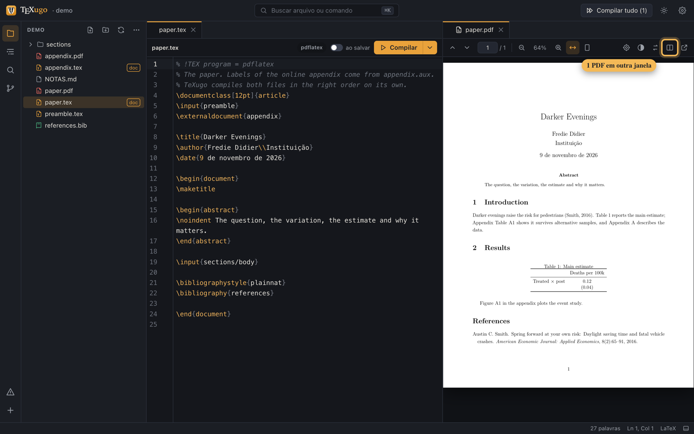
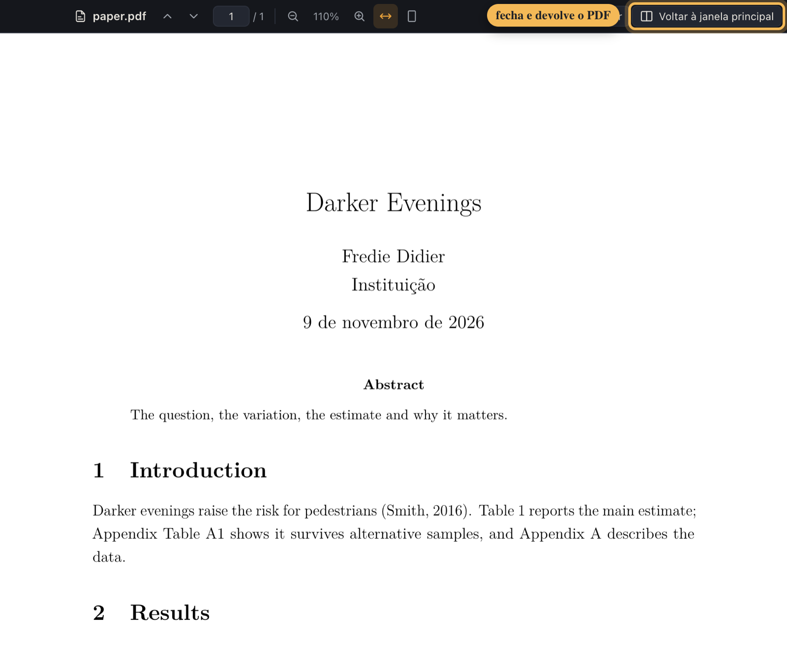
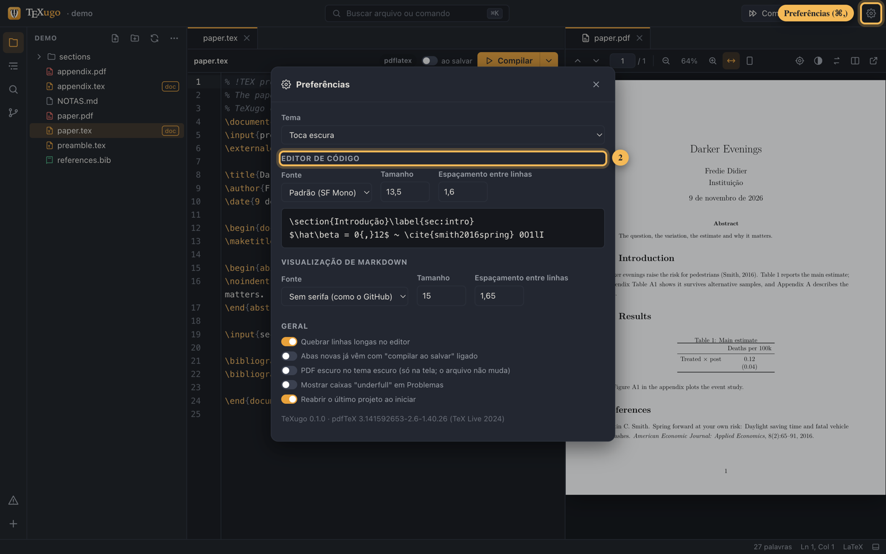
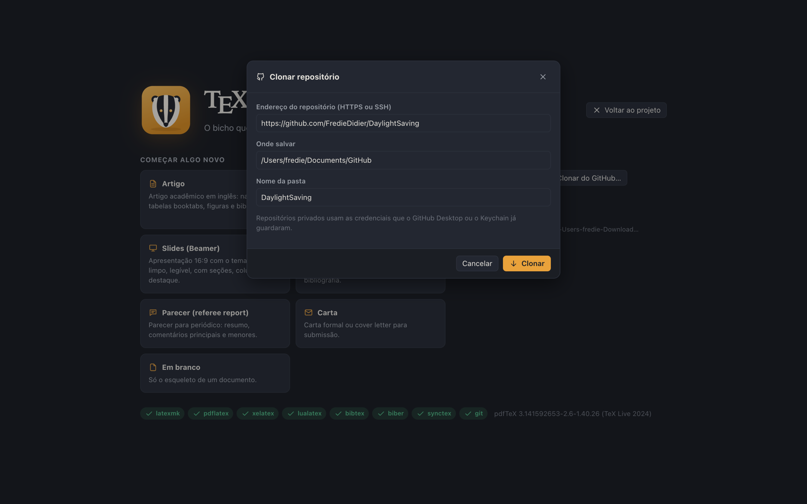
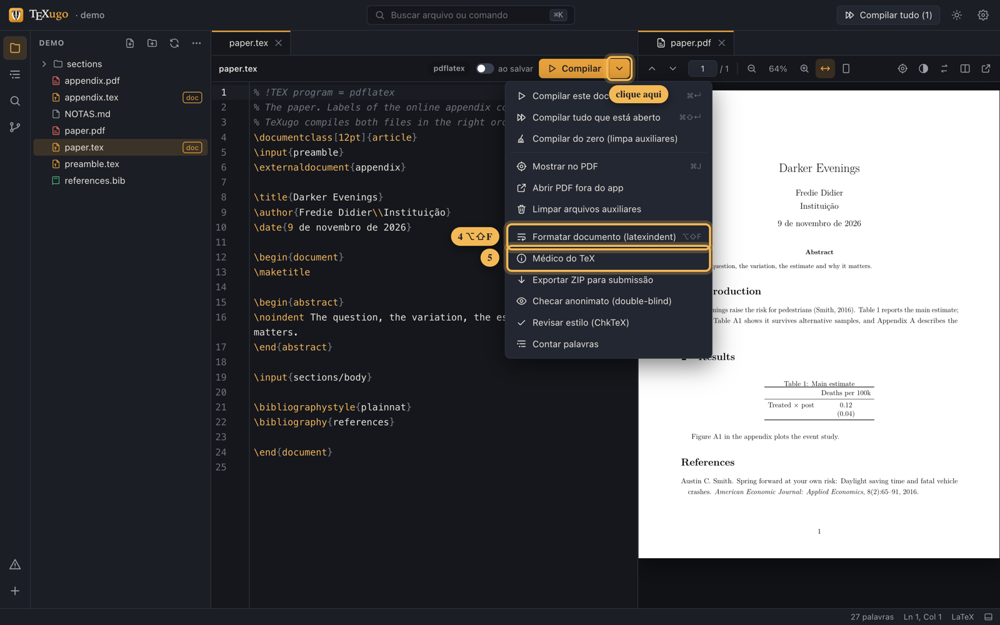
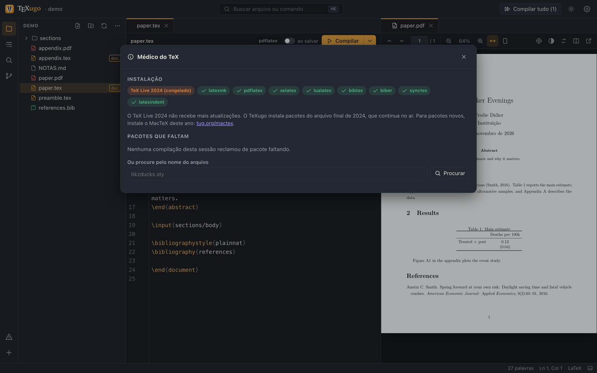
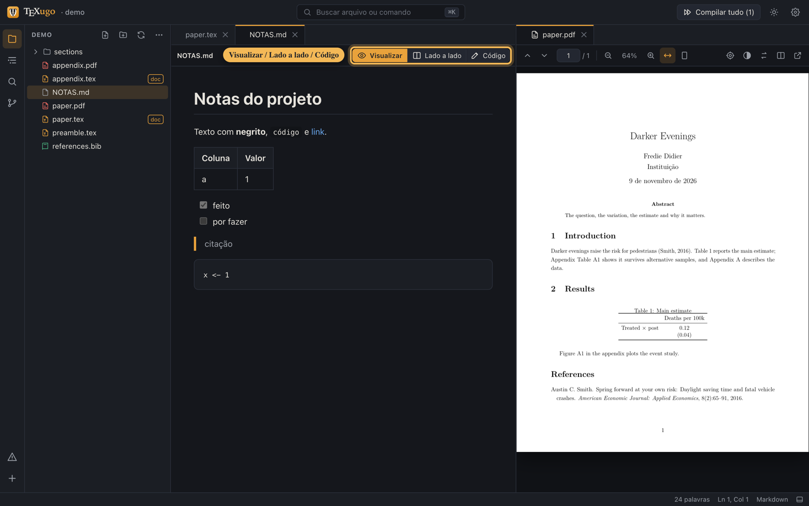

# Guia rápido do TeXugo

1. **PDF numa janela separada:** botão de duas colunas na barra do PDF.
   
   A janela nova recarrega a cada compilação. Fechar a janela devolve o PDF.
   
2. **Fonte, tamanho e espaçamento:** engrenagem no canto superior direito (⌘,).
   
3. **Clonar do GitHub:** tela inicial (⌘K → "Tela inicial") → "Clonar do GitHub…".
   
   
4. **Formatar documento** e 5. **Médico do TeX:** setinha ao lado de "Compilar". O atalho para formatar é ⌥⇧F.
   
   
- **Markdown:** um `.md` abre renderizado; os botões no topo trocam o modo.
  
